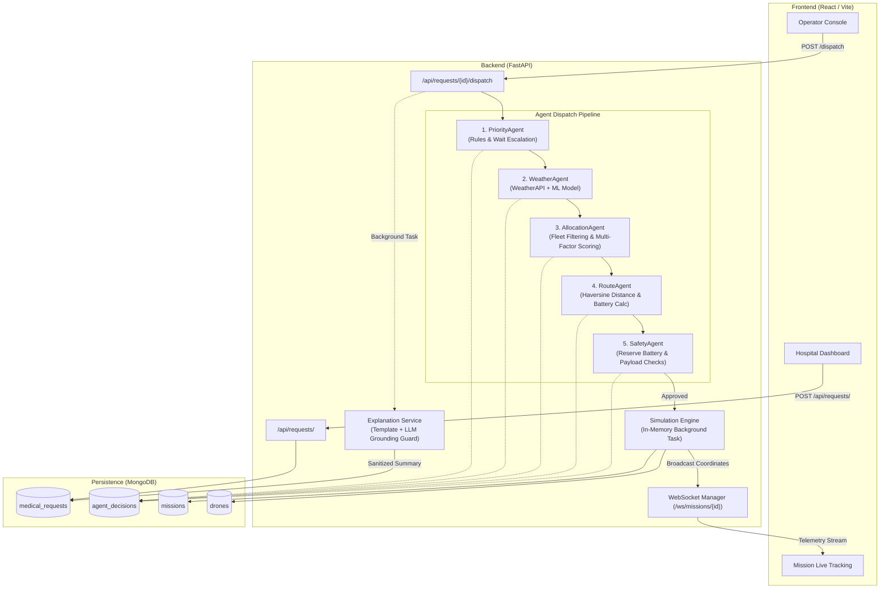
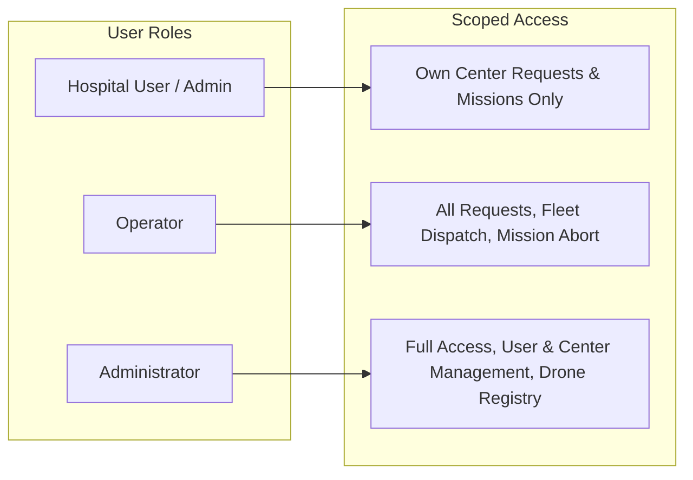

# AI-Powered Medical Drone Delivery Management and Simulation Platform

> **IMPORTANT DISCLAIMER**: This system is a **software SIMULATION only**. It connects to no physical aircraft, autopilot hardware, telemetry radios, or aviation command links. It is **NOT certified**, approved, or intended for real-world medical-drone flights, emergency healthcare operations, or airspace navigation.

---

## 1. Overview
The **AI-Powered Medical Drone Delivery Management and Simulation Platform** models and tests the full operational lifecycle of automated medical drone deliveries across urban healthcare networks (modeled around Bengaluru, India).

The platform simulates:
- Clinicians placing urgent delivery requests (blood units, emergency pharmaceuticals, vaccines).
- Multi-agent dispatch pipeline evaluating priority, flight weather risks via ML, drone fleet allocation, haversine routes, and safety clearance.
- Autonomous discrete-time mission simulation tracking in-flight drones via WebSockets.
- Plain-English, guard-checked decision explanations generated via template or LLM.

---

## 2. Features That Actually Exist in the Codebase

- **Hospital Request Flow**:
  - Hospital staff submit delivery requests with medication type, urgency tier (`LOW`, `MEDIUM`, `HIGH`, `CRITICAL`), payload weight, item count, and pickup/destination coordinates.
  - Automatic base priority classification on request creation (`Normal`, `Medium`, `High`, `Critical`).
  - Scoped hospital access: hospital users only see requests and missions originating from or destined for their assigned medical center.

- **Operator Dispatch Console & Decision Trail**:
  - Centralized operational queue sorted by urgency tier and wait time.
  - One-click multi-agent dispatch execution.
  - Transparent audit trail persisting structured decision records (`agent_decisions` collection) for each stage: Priority, Weather, Allocation, Route, and Safety.
  - Natural-language summary card (`GET /api/requests/{id}/summary`) highlighting key facts and decision rationale.

- **Live Tracking & WebSocket Telemetry**:
  - Real-time mission simulation streaming waypoint coordinates, speed, battery drain, and ETA over WebSockets (`/ws/missions/{mission_id}`).
  - MapLibre GL frontend visualization rendering route paths, pickup hubs, delivery drop sites, and live moving drone markers.
  - Distinct state cards for terminal states (`DELIVERED`, `FAILED`, `CANCELLED`).

- **Role-Based Access Control (RBAC)**:
  - JWT authentication using HS256 and bcrypt password hashing.
  - Roles enforced at endpoint level: `hospital`, `operator`, and `admin`.

- **Machine Learning Weather Flight Gate**:
  - Gradient boosting classifier (`models/weather_flight_condition.joblib`) trained to predict flight safety labels (`SAFE`, `CAUTION`, `UNSAFE`) from atmospheric inputs.
  - Real-time weather ingestion from WeatherAPI with automatic fail-closed fallback to `UNSAFE` on network or API failures.

- **Natural Language Explanation Service with Grounding Guard**:
  - Deterministic template summary built strictly from verified operational facts.
  - Optional provider-agnostic LLM upgrade (e.g. Groq, OpenAI).
  - Grounding Guard enforcing strict verification: strips markdown formatting, normalizes word numbers (e.g. "seven" $\rightarrow$ 7) to check against facts, and discards ungrounded qualitative weather claims.

- **Developer & Demo Switches**:
  - `WEATHER_FORCE_CONDITION`: Environment variable (`SAFE`, `CAUTION`, `UNSAFE`) bypassing the ML model for demonstration and integration testing.
  - Frontend Demo Mode: Toggle switch enabling local mock telemetry simulation for offline interface inspection.

---

## 3. Architecture

### System Pipeline


### Role & Access Architecture


---

## 4. Setup Guide

### Prerequisites
- Python 3.11+
- Node.js 18+ and npm
- MongoDB Community Server (v7.0+) running on port `27017`

### Backend Setup
1. Navigate to the backend directory and activate your virtual environment:
   ```bash
   cd backend
   python -m venv ../menv
   source ../menv/bin/activate
   pip install -r requirements.txt
   ```
2. Configure environment variables:
   ```bash
   cp .env.example .env
   ```
   *(Ensure `MONGODB_URI` points to your running Mongo instance and `JWT_SECRET` is set.)*

3. Seed initial users and fleet drones:
   ```bash
   # From the backend/ directory (with venv active):
   python scripts/seed_users.py --email admin@example.com --password <choose-a-password> --name "System Admin" --role admin
   python scripts/seed_users.py --email operator@aeromedical.com --password <choose-a-password> --name "Flight Controller" --role operator
   python scripts/seed_drones.py
   ```
   *(Note: The scripts and backend app automatically resolve settings from `backend/.env` regardless of whether you run commands from `backend/` or the repository root.)*

4. Run the FastAPI server:
   ```bash
   # For demos, testing, and evaluation (WITHOUT --reload):
   uvicorn app.main:app --host 0.0.0.0 --port 8000
   ```
   > **Note on `--reload`:** The `--reload` flag is strictly for active code development. Do NOT use `--reload` during demos or evaluations: file modifications trigger an immediate server reload which terminates active simulation tasks and fails all in-flight missions.

### Frontend Setup
1. Navigate to the frontend directory:
   ```bash
   cd ../frontend
   npm install
   ```
2. Start the Vite development server:
   ```bash
   npm run dev
   ```
3. Open `http://localhost:5173` in your browser.

### Database Maintenance & Account Removal
To remove a test user (such as `admin@example.com`) from your MongoDB development database:
```bash
mongosh medical_drone_db --eval 'db.users.deleteOne({ email: "admin@example.com" })'
```

---

## 5. Demo Walkthrough Script

### Scenario 1: Standard Happy Path (Hospital Request to Delivered Mission)
1. **Login as Hospital**:
   - Navigate to `http://localhost:5173/login`.
   - Log in with hospital credentials (or create one using `python scripts/seed_users.py --email hospital@clinic.org --password <choose-a-password> --role hospital`).
   - Create a new request: Select "Insulin", Urgency "HIGH", and submit.
   - The Hospital Dashboard displays the card showing status `Waiting for operator dispatch`.
2. **Dispatch as Operator**:
   - Log in as operator (`operator@aeromedical.com` / `<choose-a-password>`) at `/operator`.
   - Click the newly created request row in the queue.
   - Click **Dispatch**. The 5-stage agent pipeline executes immediately, assigning an available drone (e.g. `DRN-005`).
   - The decision trail populates on the right pane with each agent's rationale.
   - After ~6 seconds, the summary card refreshes with the guard-verified natural language summary.
3. **Live Tracking**:
   - Return to the Hospital Dashboard and click **Track live** (or go to `/mission/:id`).
   - Observe the live drone icon traveling along the route, battery percentage depleting, and the 6-stage timeline stepping forward (`ASSIGNED` $\rightarrow$ `DELIVERED`).

### Scenario 2: Unsafe Weather Halt Demonstration
1. In `backend/.env`, set:
   ```env
   WEATHER_FORCE_CONDITION=UNSAFE
   ```
2. Restart the backend server.
3. In the Operator Console (`/operator`), click **Dispatch** on any waiting request.
4. **Result**:
   - Dispatch halts at stage 2 (`WeatherAgent`).
   - The operator queue card shows a red alert banner: `Dispatch halted — weather is UNSAFE at pickup coordinates ... Reason: Forced by WEATHER_FORCE_CONDITION (demo).`
   - The hospital user sees status note: `Waiting: unsafe weather conditions at pickup.`
   - No drone is allocated and no mission is created.
5. Remove `WEATHER_FORCE_CONDITION` from `.env` and restart the backend to restore standard ML weather prediction.

### Scenario 3: Toggling Offline Demo Data
- On the Hospital Dashboard (`/`) or Live Mission page (`/mission/:id`), use the top header **Demo Data** toggle switch.
- When enabled, the UI runs client-side simulated telemetry without requiring active backend WebSocket streams.

---

## 6. API Overview

Generated directly from backend routing configuration:

| Method | Path | Required Role | Summary |
| :--- | :--- | :--- | :--- |
| `POST` | `/api/auth/login` | Public | Obtain a JWT access token |
| `POST` | `/api/auth/register` | Public | Register a new user |
| `GET` | `/api/dashboard/stats` | `operator`, `admin` | Get operational dashboard statistics via MongoDB aggregation |
| `GET` | `/api/drones/` | `operator`, `admin` | List all drones in the fleet |
| `GET` | `/api/drones/available` | `operator`, `admin` | List only available (ready-to-dispatch) drones |
| `PATCH` | `/api/drones/{drone_id}/status` | `admin` | Update drone status (admin only) |
| `GET` | `/api/health` | Public | Health check |
| `GET` | `/api/medical-centers/` | Authenticated (any) | List medical centers (scoped for hospital users) |
| `POST` | `/api/medical-centers/` | `admin` | Create a new medical center (Admin only) |
| `GET` | `/api/medical-centers/{center_id}` | Authenticated (any) | Retrieve a medical center by ID |
| `PUT` | `/api/medical-centers/{center_id}` | `admin` | Update a medical center (Admin only) |
| `DELETE` | `/api/medical-centers/{center_id}` | `admin` | Delete a medical center (Admin only) |
| `GET` | `/api/missions/{mission_id}` | Authenticated (any) | Get a mission by ID |
| `POST` | `/api/missions/{mission_id}/fail` | `operator`, `admin` | Fail a mission (fault injection, admin/operator only) |
| `POST` | `/api/requests/` | Authenticated (any) | Create a medical delivery request |
| `GET` | `/api/requests/` | Authenticated (any) | List medical requests (filterable, paginated) |
| `GET` | `/api/requests/{request_id}` | Authenticated (any) | Get a medical request by ID |
| `GET` | `/api/requests/{request_id}/decisions` | `operator`, `admin` | Get agent decisions for a request in execution order (operator/admin only) |
| `POST` | `/api/requests/{request_id}/dispatch` | `operator`, `admin` | Dispatch a medical request through the full agent pipeline |
| `GET` | `/api/requests/{request_id}/summary` | `operator`, `admin` | Get natural language dispatch explanation summary (operator/admin) |
| `PATCH` | `/api/users/{user_id}/center` | `admin` | Assign a medical center to a user (Admin only) |
| `POST` | `/api/weather/predict` | `operator`, `admin` | Predict flight condition from live weather data |
| `WS` | `/ws/missions/{mission_id}` | Authenticated (`?token=`) | Live mission telemetry stream |

---

## 7. Automated Tests

The test suite is split cleanly into unit tests (pure in-memory, run without MongoDB) and integration tests (live MongoDB in test database `medical_drone_test`).

### Run Commands & Verified Counts

- **Unit Tests (In-Memory)**:
  ```bash
  WEATHER_FORCE_CONDITION="" pytest -m "not integration" -q
  ```
  **Current Result**: **180 passed, 20 deselected**

- **Integration Tests (Live MongoDB)**:
  ```bash
  WEATHER_FORCE_CONDITION="" pytest -m integration -q
  ```
  **Current Result**: **20 passed, 180 deselected**

- **Total Test Count**: **200 passed**

---

## 8. Project Structure

```text
.
├── README.md
├── pytest.ini
├── backend/
│   ├── requirements.txt
│   ├── .env.example
│   ├── app/
│   │   ├── main.py
│   │   ├── agents/
│   │   │   ├── priority_agent.py
│   │   │   ├── weather_agent.py
│   │   │   ├── allocation_agent.py
│   │   │   ├── route_agent.py
│   │   │   └── safety_agent.py
│   │   ├── api/
│   │   │   ├── router.py
│   │   │   ├── auth.py
│   │   │   ├── dashboard.py
│   │   │   ├── drones.py
│   │   │   ├── health.py
│   │   │   ├── medical_centers.py
│   │   │   ├── missions.py
│   │   │   ├── requests.py
│   │   │   ├── users.py
│   │   │   ├── weather.py
│   │   │   └── websockets.py
│   │   ├── core/
│   │   │   ├── config.py
│   │   │   ├── logging.py
│   │   │   └── security.py
│   │   ├── db/
│   │   │   └── database.py
│   │   ├── ml/
│   │   ├── repositories/
│   │   ├── routing/
│   │   ├── schemas/
│   │   ├── services/
│   │   │   ├── explain.py
│   │   │   └── weather_client.py
│   │   ├── simulation/
│   │   │   ├── engine.py
│   │   │   └── recharge.py
│   │   └── websocket/
│   │       └── manager.py
│   ├── scripts/
│   │   ├── migrate_roles.py
│   │   ├── seed_drones.py
│   │   └── seed_users.py
│   └── tests/
│       ├── test_auth.py
│       ├── test_drone_logic.py
│       ├── test_explain_integration.py
│       ├── test_explain_unit.py
│       ├── test_integration.py
│       ├── test_orphaned_missions.py
│       ├── test_phase3.py
│       ├── test_phase6.py
│       ├── test_phase7.py
│       ├── test_phase8.py
│       ├── test_phase9.py
│       ├── test_recharge.py
│       ├── test_request_status_integrity.py
│       ├── test_security.py
│       └── test_weather_ml.py
├── frontend/
│   ├── package.json
│   ├── vite.config.js
│   ├── index.html
│   └── src/
│       ├── App.jsx
│       ├── components/
│       │   └── WorldMap.jsx
│       ├── pages/
│       │   ├── Dashboard.jsx
│       │   ├── Login.jsx
│       │   ├── MissionDetails.jsx
│       │   └── OperatorConsole.jsx
│       ├── services/
│       │   └── api.js
│       ├── store/
│       │   └── auth.js
│       └── styles/
│           ├── hud.css
│           └── tokens.css
├── ml/
│   ├── predict.py
│   └── train.py
└── models/
    └── weather_flight_condition.joblib
```

---

## 9. Limitations & Known Trade-offs

1. **Weather Model Training Data**:
   The gradient boosting classifier in `models/weather_flight_condition.joblib` was trained on synthetic labels generated from hard-coded rules on precipitation and visibility. It has **not** been validated against real aviation flight data, and wind speed has virtually no statistical influence on its decision boundary.
2. **Routing Model**:
   Flight distance and trajectory calculations rely solely on spherical straight-line Haversine math. There is **no awareness** of civil airspace classes, dynamic no-fly zones (NFZs), terrain elevation, obstacles, buildings, or wind drift.
3. **Simulation Concurrency & Process Failure**:
   Active missions execute as in-memory asyncio background tasks in a single process. If the backend process crashes or restarts, all active missions are flagged `FAILED` (orphaned mission recovery); there is **no horizontal scaling** or distributed task queue (e.g. Celery / Temporal).
4. **Reallocation Workflow**:
   If the `SafetyAgent` returns `REQUEST_REALLOCATION`, the dispatch halts. The platform does not loop autonomously; an operator must manually re-trigger dispatch.
5. **Wait-Time Escalation**:
   Priority scores for pending requests escalate only at the moment a dispatch is initiated, rather than continuously in the database background.
6. **LLM Explanations & Third-Party Sharing**:
   Natural-language summaries are strictly optional. When an LLM API key is provided, sanitized operational facts (drone IDs, coordinates, medical payload weights) are transmitted to a third-party inference provider. A grounding guard rejects hallucinated numbers, but cannot guarantee stylistic perfection.
7. **Demo Switches**:
   Demo controls (`WEATHER_FORCE_CONDITION` and frontend mock simulation mode) exist directly in the codebase for presentation purposes.
8. **Client-Side Auth Storage**:
   JWT access tokens are persisted in browser `localStorage`. While standard for SPAs, this presents a known XSS vulnerability trade-off compared to hardened HTTP-only secure cookie sessions.
9. **Prototype Metrics**:
   Battery consumption rates (1.5% per km), reserve thresholds (20%), drone speed (60 km/h), and recharge times are prototype heuristics, not calibrated to physical drone dynamics.
